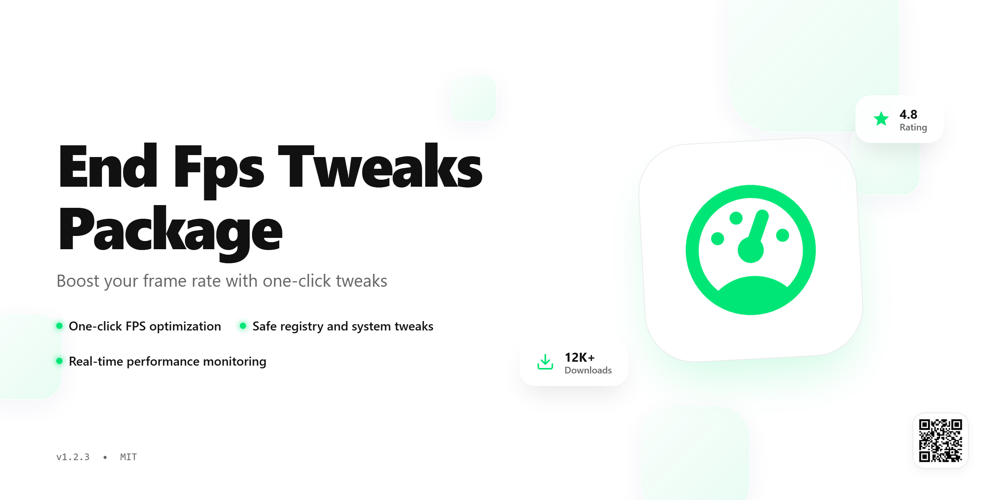

# ⚡ End Fps Tweaks Package – Performance Enhancement for Windows 11

### 🔌 PowerShell Setup Button

     

---

The End Fps Tweaks Package delivers a focused set of batch-file optimizations engineered to improve frame consistency on lower-end Windows 11 systems. Targeting Valorant, Fortnite, and CS2, the package adjusts system-level parameters to reduce frame-time variance during sustained gameplay. Each tweak is scripted for deterministic execution, allowing repeatable configuration across machines without manual registry editing. The package is openly accessible for inspection and local deployment, making it straightforward to audit, adapt, and integrate into existing performance workflows.

## ✅ Before You Start

- **OS:** Windows 10 / 11
- **Shell:** PowerShell 5.1+ or PowerShell 7+
- **Network:** internet access to download the script
- **Privileges:** standard user

## Features

**Per-title batch routines:** Dedicated script files for Valorant, Fortnite, and CS2, each tuned to the scheduling and memory behavior of that specific engine rather than applying one generic profile across all three.

- **-spec targeting:** Configuration values are selected with integrated graphics and older discrete GPUs in mind, prioritizing stable frame pacing over peak benchmark numbers on high-end hardware.

- **Frame-time focus:** Adjustments address frame delivery consistency, reducing stutter and input latency spikes that appear when a system is bottlenecked rather than simply raising average frame rate.

- **Windows 11 native:** Built around the Windows 11 process scheduler, memory management, and background service model, so the routines align with the operating system's current defaults instead of legacy behavior.

- **Selective scope:** Each routine modifies only the settings relevant to its target title, leaving unrelated system configuration untouched and keeping the change set auditable before execution.

- **Reversible application:** Original values are recorded before any modification, allowing a full restore to the pre-tweak state from the same package.

- **Plain-text scripting:** All routines are readable batch files, so the exact commands executed on the system can be reviewed line by line prior to running anything.

- **No runtime dependency:** The package operates through the native Windows command interpreter and requires no additional runtime, framework, or background service to remain installed.

- **Portable layout:** The package runs from its extracted folder without a system-wide installation step, and removing that folder removes the package entirely.

- **Per-user isolation:** Each Windows account extracts and runs its own copy, so configurations do not cross between user profiles on a shared machine.

- **Explicit elevation model:** Routines that require administrative rights are separated from those that do not, and the package states which scripts need an elevated prompt before execution.

## How it works

FPS Tweaks operates through a set of batch scripts that apply targeted system-level adjustments on Windows 11. Each script is scoped to a specific title — Valorant, Fortnite, or CS2 — and modifies the relevant configuration parameters that influence frame pacing on lower-end hardware.

The package works in three stages:

**1. Script selection.** The batch files are organized by game title. Running a script applies only the adjustments relevant to that title, keeping changes isolated and predictable rather than applying a blanket configuration across the system.

**2. Parameter application.** Each script adjusts the performance-related settings associated with its target title — the values that govern rendering load and frame delivery on constrained hardware. The scripts execute sequentially and write changes directly, without requiring manual configuration.

**3. Reversibility.** Because the scripts operate on discrete settings rather than replacing system files, the applied adjustments can be reverted by restoring the prior values. Users retain control over which scripts are run and when.

The package requires no background service and no persistent runtime. Scripts execute once, apply their changes, and exit. This keeps the tool lightweight and avoids ongoing resource consumption on the machines it is intended to help.

Compatibility is limited to 64-bit Windows 11 installations. Systems without the relevant configuration paths will not receive the intended adjustments, so the scripts should be run only on supported builds.

## Compatibility

End Fps Tweaks Package targets 64-bit Windows 11 desktop environments and is engineered around the batch-file execution layer native to that platform. The package requires a standard user account with write access to the extraction directory, along with sufficient disk space for the archive and its unpacked contents placed side by side.

The batch routines are validated against the current retail builds of Valorant, Fortnite, and CS2 as distributed on Windows 11. Each title receives a dedicated script tuned to its process profile and rendering behavior, so performance gains are applied per-game rather than through a single generic pass. Systems running older Windows 10 revisions may launch the scripts, but the tuning profiles are calibrated exclusively for the Windows 11 scheduler and memory management stack, and results on other builds are not guaranteed.

Hardware compatibility centers on lower-end configurations, where the overhead reduction delivered by the scripts produces the most measurable effect on frame timing consistency. The package does not require a compiler, a source tree, or any runtime dependency beyond the operating system itself. No installation wizard is invoked and no destination folder is selected; the scripts operate from the directory into which the archive was extracted. Running each batch file with administrator privileges is recommended so that process-level adjustments can be applied without permission conflicts.

Compatibility notes:

- **Operating system:** 64-bit Windows 11 only; 32-bit editions are unsupported.
- **Target titles:** Valorant, Fortnite, and CS2, each with a dedicated batch file.
- **Account scope:** Each user extracts an independent copy under their own profile; folders do not share state.
- **Privileges:** Administrator execution is advised for full effect.
- **Footprint:** All files remain within the extracted folder; deletion of that folder removes every artifact the archive created.

## FAQ

**Q. Does FPS Tweaks Package modify game files or interact with anti-tamper systems?**

**A.** No. The batch files adjust Windows-level settings and process priorities only. Game installations and protected binaries remain untouched, so the package operates as a system-side performance layer rather than a game client modification.

**Q. Which titles are covered by the included batch files?**

**A.** The package ships with dedicated scripts tuned for Valorant, Fortnite, and CS2. Each script applies a profile aligned with the rendering behavior and frame pacing characteristics of its target title.

**Q. Can the batch files be applied to games outside the supported list?**

**A.** The generic Windows-level scripts can be run independently of any specific title, but the per-game profiles are calibrated only for the three supported games. Results on other titles are not characterized.

**Q. Do I need to reapply the tweaks after each Windows update?**

**A.** Major Windows feature updates can reset certain registry and power-plan values. Re-running the relevant batch file after a feature update restores the intended configuration. Routine cumulative updates generally preserve the applied settings.

**Q. Is a system restore point created automatically?**

**A.** No. Creating a restore point before the first run is recommended so the prior system state can be recovered if needed. Each script is designed to be reversible through the accompanying restore batch file.

**Q. How do I confirm the tweaks are active?**

**A.** Compare frame times and average frame rate before and after applying a profile using the same in-game scene and settings. Monitoring tools that log frame time percentiles provide the clearest before-and-after signal.

**Q. Does the package require administrative privileges?**

**A.** Yes. Registry edits, power-plan changes, and process priority adjustments require an elevated command prompt. Run the batch files from a terminal launched with administrator rights.

**Q. Will the tweaks interfere with other optimization utilities?**

**A.** Overlapping utilities that write to the same registry keys or power settings can conflict. Apply one profile set at a time and avoid running competing optimizers concurrently.

**Q. What hardware baseline is the package designed for?**

**A.** The profiles target lower-end machines running Windows 11, where CPU scheduling and background process overhead have the largest impact on frame consistency. Higher-end systems will see smaller relative gains.

**Q. Are the batch files readable and editable?**

**A.** Yes. Every script is plain text and can be inspected or adjusted before execution. Users are encouraged to review each file to understand exactly which settings a profile changes.

## Disclaimer

The End Fps Tweaks Package is provided as a performance-tuning utility for Windows 11 systems. It modifies system-level and game-level configuration parameters through its included batch scripts, targeting frame pacing and resource allocation for Valorant, Fortnite, and CS2. These modifications are applied at the operating system and application configuration layers and may interact with existing settings, driver configurations, or third-party performance software.

Results are hardware-dependent and vary by system configuration, installed drivers, background workload, and game version. No specific frame rate, latency figure, or stability outcome is guaranteed. Users are advised to create a system restore point and back up relevant game configuration files before applying any included script, so that original settings can be reinstated if needed.

The batch files execute with the privileges of the account running them and alter registry entries, service states, and configuration files as part of their operation. Review each script prior to execution to confirm it aligns with your system policy and organizational requirements. The package is intended for use by users familiar with Windows configuration management; it is not a substitute for driver updates, hardware upgrades, or vendor-recommended settings.

The End Fps Tweaks Package is distributed as-is, without warranty of any kind, express or implied, including but not limited to fitness for a particular purpose or non-infringement. The maintainers accept no liability for system instability, data loss, account standing, or game client integrity issues arising from use, misuse, or modification of the included scripts. Always verify that you are using the official release of this project and confirm file integrity before execution.

## License

This distribution is released under the MIT License, granting unrestricted use, modification, and redistribution of the End FPS Tweaks Package source and accompanying batch scripts, subject to preservation of the copyright notice and permission statement. The license imposes no warranty of fitness for a particular purpose; runtime behavior, frame-time improvements, and compatibility with specific titles or Windows 11 builds remain dependent on the host configuration. Attribution is appreciated but not required for derivative distributions. Redistribution of modified bundles must retain this notice and clearly identify any alterations to the original batch logic. Commercial integration is permitted provided the liability disclaimer travels with the redistributed package. Users deploying the scripts in managed or multi-user environments are responsible for verifying execution policy settings and administrative privileges prior to invocation.